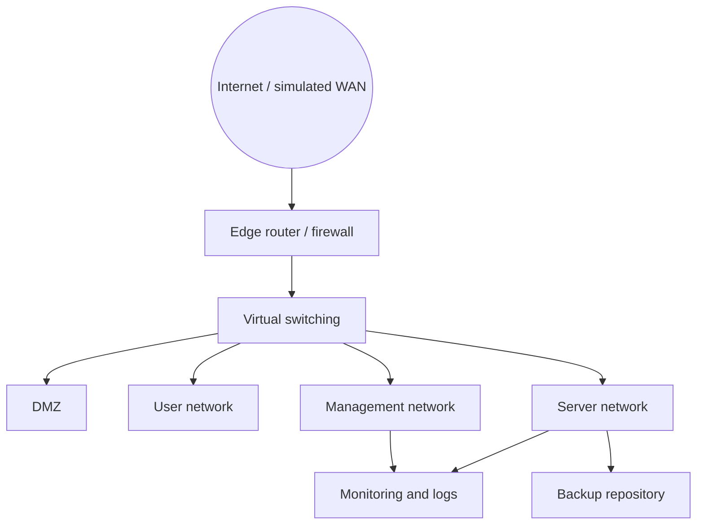

# Enterprise Infrastructure & Security Lab

**DESIGN · SEGMENT · PROTECT · OBSERVE · RECOVER**

An isolated, documented enterprise-style infrastructure learning lab.

Networks · Systems Administration · Virtualization · Defensive Security · Monitoring · Backup & Recovery

---

## Project status

Documentation and design baseline · Deployment and test completion are tracked separately.

This repository is a reproducible learning project for designing, deploying and validating a small enterprise-style IT infrastructure. It focuses on networking, systems administration, resilience, security controls and monitoring.

> **Important:** this architecture is a target lab design, not a claim that every component has already been deployed or tested. Implementation evidence and test results will be added as phases are completed.

## 01 / Objectives

- Design a segmented network with clear trust boundaries.
- Practice Linux and Windows systems administration.
- Explore virtualization and core infrastructure services.
- Apply practical defensive security controls.
- Establish service and infrastructure monitoring.
- Document backup, restoration and continuity procedures.
- Validate the lab through repeatable, non-destructive tests.

## 02 / Reference architecture

Internet or simulated WAN → Edge router/firewall → Virtual switching → DMZ, User, Server and Management zones. Server and Management zones send telemetry to Monitoring. Server workloads use a restricted Backup repository.

This is a logical reference. Actual VLAN IDs, addressing, products and host counts will be documented only after selection and testing.

## 03 / Repository map

| Path | Purpose |
|---|---|
| `docs/architecture/` | Architecture and network design |
| `docs/security/` | Defensive controls and hardening |
| `docs/monitoring/` | Monitoring and log strategy |
| `docs/backup-recovery/` | Backup, restore and continuity |
| `docs/validation/` | Test plan and evidence criteria |
| `docs/implementation-status.md` | Planned / implemented / tested status |
| `lab-notes/` | Dated implementation notes |
| `diagrams/` | Source diagrams |
| `scripts/` | Reviewed lab helper scripts |

## 04 / Suggested implementation phases

1. **Foundation** — hypervisor, virtual networks, addressing plan and inventory.
2. **Core services** — identity, DNS, DHCP, time synchronization and file services as selected.
3. **Segmentation** — user, server, management and DMZ zones with documented traffic requirements.
4. **Security** — least privilege, hardening, firewall policy, patching and endpoint protection.
5. **Observability** — availability, resource, service and security-event monitoring.
6. **Resilience** — backup policy, restore exercises and recovery documentation.
7. **Validation** — repeatable tests, findings, remediation and final report.

## 05 / Engineering principles

- Isolated lab only; do not connect experimental systems to production networks.
- Use synthetic identities and sample data.
- Never commit passwords, private keys, tokens, VPN profiles or employer-confidential material.
- Keep secrets outside Git and use placeholders in examples.
- Prefer documented, reversible and non-destructive validation.
- Mark each feature as **Planned**, **Implemented** or **Tested** with evidence.

## 06 / Documentation

- [Architecture overview](docs/architecture/overview.md)
- [Network design](docs/architecture/network-design.md)
- [Security controls](docs/security/security-controls.md)
- [Monitoring strategy](docs/monitoring/monitoring-strategy.md)
- [Backup and recovery plan](docs/backup-recovery/backup-recovery-plan.md)
- [Validation plan](docs/validation/validation-plan.md)
- [Implementation status](docs/implementation-status.md)
- [Lab notes](lab-notes/README.md)
- [Scripts policy](scripts/README.md)
- [Architecture diagram source](diagrams/architecture-overview.mmd)

## 07 / Status and evidence

See [Implementation status](docs/implementation-status.md). No deployment or test is considered complete until its result is recorded.

## Author

**Houssam Essaki** · Final-year State Engineering student — Networks, Systems & Security

- [Portfolio](https://houssamessaki.vercel.app/)
- [LinkedIn](https://www.linkedin.com/in/houssam-essaki/)
- [GitHub](https://github.com/HoussamEssaki)

---

Personal learning project. Not affiliated with or representative of any employer or client environment.
