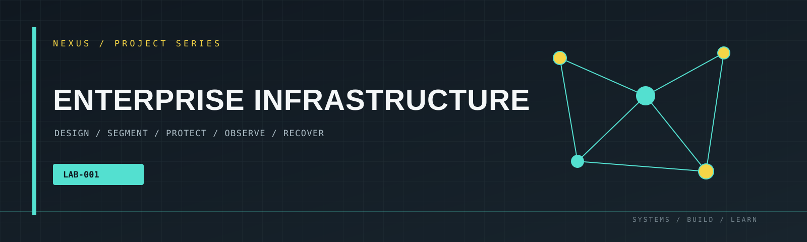
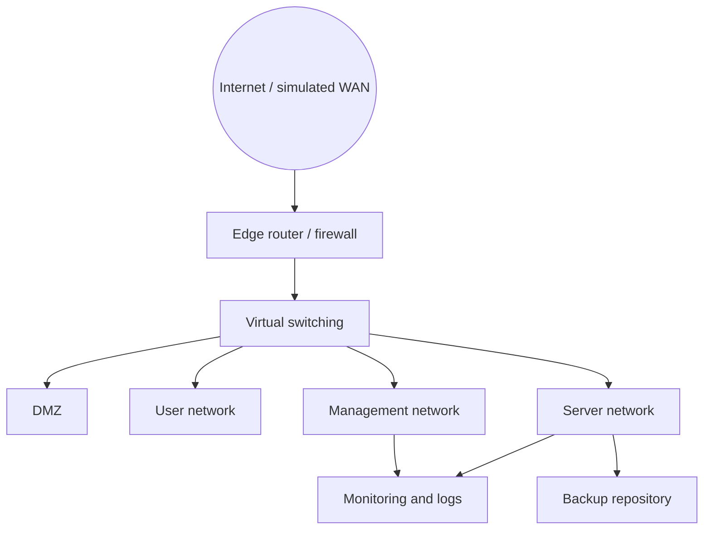

# Enterprise Infrastructure & Security Lab

**DESIGN · SEGMENT · PROTECT · OBSERVE · RECOVER**

An isolated, documented enterprise-style infrastructure learning lab.

Networking · Systems · Virtualization · Defensive Security · Monitoring · Backup & Recovery · Documentation

---

## Project status

Documentation baseline · Implementation and validation tracked separately

This repository is a structured learning project for designing, building, documenting and validating a small enterprise-style infrastructure. It is intended to demonstrate disciplined infrastructure engineering: requirements, architecture, inventories, defensive controls, monitoring, recovery, validation and evidence.

> **Status integrity:** diagrams and component lists describe a target design unless a status entry and evidence explicitly indicate that deployment or testing occurred. This repository does not claim production readiness.

## 01 / Objectives

- Design an understandable architecture with trust boundaries.
- Practice virtualization, network engineering and Linux/Windows administration.
- Document core services and dependencies.
- Explore segmentation and defensive security controls.
- Build monitoring coverage and useful alerting.
- Establish backup and restore validation.
- Maintain repeatable, sanitized evidence and findings.

## 02 / Reference architecture

Internet or simulated WAN → Edge router/firewall → Virtual switching → DMZ, User, Server and Management zones. Selected telemetry flows to Monitoring. Backup access is separately restricted.

This is a logical reference, not a measured topology. Actual addressing, VLAN IDs, hardware, software versions and service flows are recorded only after selection and validation.

## 03 / Engineering workflow

1. **Plan** — scope, constraints, requirements, assets and decisions.
2. **Design** — topology, zones, addressing, dependencies and traffic requirements.
3. **Build** — isolated environment, one component at a time.
4. **Protect** — access control, hardening, patching and defensive telemetry.
5. **Observe** — health checks, dashboards, logs and alert review.
6. **Recover** — backups, isolated restoration and recovery evidence.
7. **Validate** — test records, findings, retests and limitations.
8. **Publish** — sanitized documentation and evidence; no confidential details.

## 04 / Repository guide

### Architecture
- [Architecture overview](docs/architecture/overview.md)
- [Network design](docs/architecture/network-design.md)
- [Service dependency map](docs/architecture/dependency-map.md)
- [Infrastructure components](docs/infrastructure-components.md)
- [Technology map](docs/technology-map.md)

### Project management
- [Project charter](docs/project-charter.md)
- [Roadmap](docs/project-roadmap.md)
- [Learning and build plan](docs/learning-plan.md)
- [Implementation status](docs/implementation-status.md)
- [PFA portfolio summary](docs/pfa-project-summary.md)

### Security and operations
- [Security controls](docs/security/security-controls.md)
- [Monitoring strategy](docs/monitoring/monitoring-strategy.md)
- [Monitoring catalogue](docs/operations/monitoring-catalogue.md)
- [Maintenance checklist](docs/operations/maintenance-checklist.md)
- [Findings register](docs/operations/findings-register.md)
- [Backup and recovery plan](docs/backup-recovery/backup-recovery-plan.md)
- [Validation plan](docs/validation/validation-plan.md)
- [Glossary](docs/glossary.md)

### Reusable templates
- [Asset inventory](docs/templates/asset-inventory.md)
- [Traffic requirements matrix](docs/templates/traffic-matrix.md)
- [Evidence record](docs/templates/evidence-record.md)
- [Architecture decision record](docs/templates/decision-record.md)
- [Change record](docs/templates/change-record.md)

### Repository policies and sources
- [Lab notes](lab-notes/README.md)
- [Scripts policy](scripts/README.md)
- [Contributing](CONTRIBUTING.md)
- [Security policy](SECURITY.md)
- [Architecture diagram source](diagrams/architecture-overview.mmd)

## 05 / Status conventions

| Label | Meaning |
|---|---|
| Planned | Proposed; not yet deployed |
| Implemented | Deployed; evidence reference recorded |
| Tested | Relevant validation passed and evidence recorded |
| Failed | Validation did not meet expectation |
| Blocked | Cannot complete due to a documented constraint |
| N/A | Explicitly out of scope with rationale |

## 06 / Safety and quality principles

- Isolated lab only; do not connect experimental systems to production.
- Use synthetic identities and sample data.
- Never commit passwords, private keys, tokens, VPN profiles or employer-confidential material.
- Keep secrets outside Git; use placeholders.
- Prefer documented, reversible and non-destructive validation.
- Record assumptions, dependencies, scope and limitations.
- Review public evidence for secrets and privacy risks.
- Do not represent a planned or simulated component as implemented or tested.

## 07 / Current focus

Start with the [implementation status](docs/implementation-status.md) and [Phase 1 roadmap](docs/project-roadmap.md). Select a platform within available resources, establish isolation and inventory, then implement a minimal service set. Avoid deploying every listed technology simultaneously.

## Author

**Houssam Essaki** · Final-year State Engineering student — Networks, Systems & Security

- [Portfolio](https://houssamessaki.vercel.app/)
- [LinkedIn](https://www.linkedin.com/in/houssam-essaki/)
- [GitHub](https://github.com/HoussamEssaki)

---

Personal learning project. Not affiliated with or representative of any employer or client environment.
